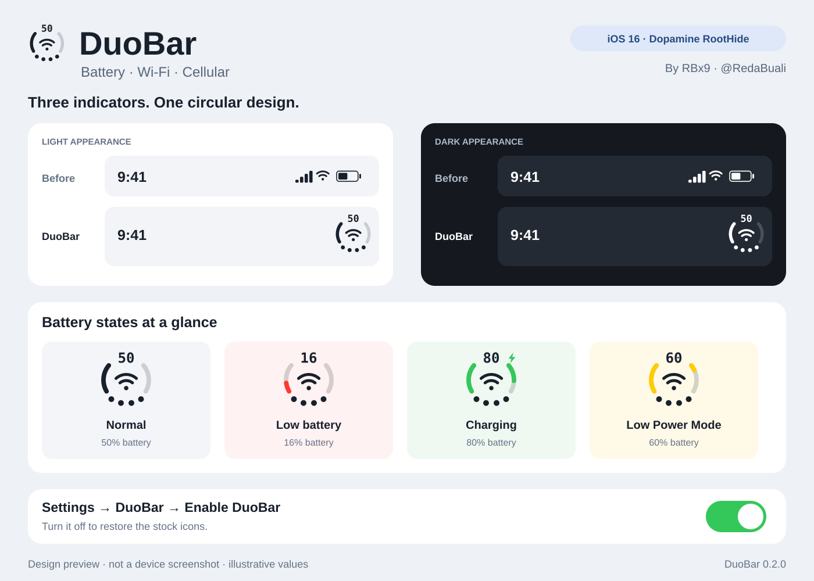

# DuoBar

An iPhone Duo-inspired status bar for **iOS 16 with Dopamine RootHide or standard Rootless**. DuoBar brings battery percentage, Wi-Fi strength, and cellular signal together in one circular icon.

Developed by **RBx9** · [X: @rmbx09](https://x.com/rmbx09)



*Design preview drawn from the tweak’s icon geometry; not a device screenshot.*

## Install using Sileo (recommended)

1. Open **Sileo → Sources → +**.
2. Add the **RBx9 Repo** source: **https://rbx9.github.io/**
3. Refresh sources, open **RBx9 Repo**, and install **DuoBar**.
4. Respring, then open **Settings → DuoBar** to configure it.

The **RBx9 Repo** hosts two distinct iOS 16 packages: **DuoBar (RootHide)** for Dopamine RootHide and **DuoBar (Rootless)** for standard Rootless/Dopamine. Install only the package matching your jailbreak.

## Download .deb manually

[**DuoBar v2.7.2 release (RootHide and Rootless)**](https://github.com/RBx9/DuoBar/releases/tag/v2.7.2) · [Previous stable v2.7.1](https://github.com/RBx9/DuoBar/releases/tag/v2.7.1)

- **Dopamine RootHide:** [DuoBar_2.7.2_RootHide.deb](https://github.com/RBx9/DuoBar/releases/download/v2.7.2/DuoBar_2.7.2_RootHide.deb) (`local.duobar`, `iphoneos-arm64e`)
- **Standard Rootless (Dopamine, palera1n):** [DuoBar_2.7.2_Rootless.deb](https://github.com/RBx9/DuoBar/releases/download/v2.7.2/DuoBar_2.7.2_Rootless.deb) (`local.duobar.rootless`, `iphoneos-arm64`, arm64 and arm64e slices). See [Rootless compatibility and installation](docs/ROOTLESS.md).

No compiling is needed. The RootHide package uses `iphoneos-arm64e`; standard Rootless uses `iphoneos-arm64`.

## Features

- Battery percentage above an open circular charge ring.
- Wi-Fi strength in the center, a compact 5G/LTE label, and four cellular signal dots below.
- Smooth Control Center opening and closing: DuoBar lands exactly in place, with no jump (v2.7.2).
- Charging indicator, low-battery red, and Low Power Mode yellow.
- Light and dark status-bar styling, with clear gaps around the cellular dots.
- A persistent **Enable DuoBar** switch in **Settings → DuoBar**.
- Adjustable **DuoBar Size** slider (70%–140%), a current-size percentage, and Reset Size to 100%. Changes apply without respringing.
- Fixes for duplicate battery percentage and rotation-lock icon overlap in Control Center.
- **v0.2.5 RootHide:** Personal Hotspot chain-link inside DuoBar, reliable Control Center rotation-lock spacing and no brief native-icon flash during transitions.
- A clean transparent Settings icon and organized preference page with direct **RBx9 Repo** and **Sileo source** links.
- **Report a Bug** and **Help Test Other iOS Versions** email actions in Settings; bug reports suggest attaching a screenshot or short video.
- Improved links and update options in **Settings → DuoBar → Links & Updates**.
- v0.2.2 fixes PreferenceLoader icon discovery by including icon sizes in the actual preferences bundle.

## Manual installation

1. Download the `.deb` on your jailbroken iPhone.
2. Open it in your RootHide package manager or RootHide-compatible Filza and install it.
3. Respring once, then reopen Settings and any apps that were already running.
4. Open **Settings → DuoBar** to turn the design on or off. Switch changes apply immediately.

Existing DuoBar installations can be upgraded with the same package. See the [installation guide](docs/INSTALL.md) for more detail.

## Compatibility

**Supported: iOS 16.0–16.7.x** on a jailbroken iPhone with tweak injection and PreferenceLoader. Both packages refuse to install on other iOS versions.

| Jailbreak | iPhones (on an iOS 16 build the jailbreak supports) | Package |
|---|---|---|
| Dopamine (Rootless) | iPhone XS, XS Max, XR, 11 series, SE (2nd and 3rd generation), 12 series, 13 series, 14 series | Rootless |
| Dopamine RootHide | Same iPhones as Dopamine | RootHide |
| palera1n (Rootless) | iPhone 8, 8 Plus, X | Rootless |

**Not supported:** iOS 17, 18 and 26 on any iPhone; iPhone 15 and newer (no iOS 16, and no public jailbreak on the iPhone 16, 17 and 18); iPad (untested).

**Testing:** v2.7.2 was tested on an iPhone 14 Pro Max with iOS 16.4.1 (as beta 8: stable, Control Center close fix confirmed) and in the iOS 16.4 simulator inside SpringBoard on the iPhone 12, 13 mini, 14, 14 Pro, 14 Pro Max and SE. v2.7.1 Rootless was community-tested on real iPhones. Details, sources and the iOS 17–26 findings are in [docs/COMPATIBILITY.md](docs/COMPATIBILITY.md); the [device checklist](docs/DEVICE-TESTING.md) covers further testing.

## Build from source

Both installers are compiled by GitHub Actions with the official Theos toolchains (RootHide Theos for RootHide, standard Theos for Rootless) and checked by `scripts/verify-deb.py` before release: metadata, file modes, arm64 and arm64e slices, signatures, linkage and a warning-free build log.

Local builds require Theos, an iOS SDK, and a compatible compiler. RootHide builds require the [RootHide Theos fork](https://github.com/roothide/theos):

```sh
make clean package FINALPACKAGE=1 THEOS_PACKAGE_SCHEME=roothide
```

See [build verification](docs/BUILD-VERIFICATION.md) for the supplied binary’s toolchain, arm64e conversion, and signing details.

## License

Source code is available under the [MIT license](LICENSE).
